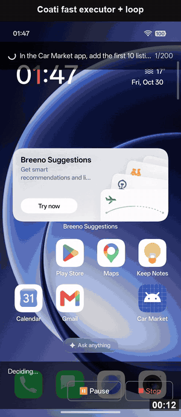
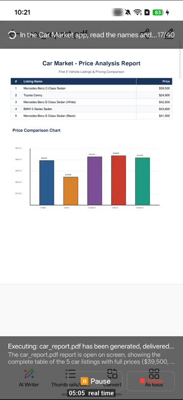

# Coati Agent

**Un agente de IA que vive en tu teléfono Android**

Dile el resultado que quieres. Coati Agent maneja tus aplicaciones, ejecuta código cuando hace falta y comprueba que el trabajo quedó hecho. Sin ordenador y sin ADB.

[English](README.md) · **Español** · [中文](README.zh-CN.md) · [日本語](README.ja.md) · [한국어](README.ko.md)

---

## Por qué Coati Agent

Tu teléfono puede hacer casi de todo, pero aún tienes que hacerlo tú: abrir una aplicación, copiar algo, cambiar a otra, tocar las mismas pantallas una vez más. Coati Agent se encarga de esa parte. Dilo con tus propias palabras y míralo trabajar en tu pantalla, como lo haría un amigo.

- **Vive en tu teléfono.** Instalas una sola aplicación. No necesitas ordenador, cable ni root.
- **Funciona con las aplicaciones que ya tienes.** Sin esperar complementos: si puedes usar una aplicación tocando la pantalla, normalmente Coati Agent también.
- **También crea cosas.** Incluye un pequeño ordenador Linux, así que puede reunir información, procesarla y entregarte un PDF, un gráfico o una hoja de cálculo.
- **Revisa su propio trabajo.** Una tarea solo cuenta como hecha cuando la pantalla lo demuestra. Si no puede confirmarlo, te lo dice.
- **Tú mandas.** Ves cada paso y puedes pausar o detener cuando quieras. Tu clave de API se queda en tu teléfono.

**Cosas que le puedes pedir:**

- *«Pon una alarma a las 7:30 los días laborables y añade Tokio a mi reloj mundial.»*
- *«Busca dos hoteles en Tokio con nota de 8,0 o más del 12 al 14 de diciembre y guarda los precios en una nota.»*
- *«Lee los cinco primeros anuncios de esta aplicación y hazme un PDF que compare sus precios.»*

No es magia: en una tarea sencilla puede ser más lento que tú y puede equivocarse, así que vigila lo que sea importante. Usa tu propia cuenta de un modelo de IA, y ese proveedor puede cobrarte por el uso.

## Empieza

Necesitas un teléfono con Android 11 o posterior (arm64, como casi todos los teléfonos recientes) y una clave de API de un modelo de IA. Lo más fácil es empezar con una [clave de Google Gemini](https://aistudio.google.com/apikey).

1. **Instala.** Descarga el APK desde [Releases](https://github.com/coati-os/coati-agent/releases/latest) en tu teléfono y ábrelo. Permite la instalación desde esa fuente si Android lo pide.
2. **Configura.** Abre Coati Agent, sigue los pasos para activar los permisos de superposición y **accesibilidad**, y escribe tu clave en *AI Model Configuration*. En Android 13 o posterior, si el interruptor de accesibilidad aparece en gris, abre la información de la aplicación en los ajustes del sistema, toca el menú **⋮** y elige permitir los ajustes restringidos.
3. **Pide.** Toca el botón flotante de Coati Agent y escribe el resultado que quieres. Un panel muestra cada paso; puedes pausar o detener cuando quieras.

## Demostraciones

### Espacio de trabajo Linux: de las aplicaciones a un archivo terminado

[Ver la grabación](https://www.coati-os.com/assets/demos/V5_linux.mp4)

### Tarea cotidiana

https://github.com/user-attachments/assets/24384019-9561-482a-ae9f-30cc6ec87f0c

### Acciones repetidas: 254 s → 47 s

https://github.com/user-attachments/assets/fb831034-b329-4b8a-a25b-fdd2b382c192

### AppMemory: 18 pasos la primera vez, 6 después

https://github.com/user-attachments/assets/e3d520af-a866-4f61-b647-075994f30fa7

### Entre aplicaciones: Booking.com → Google Keep

https://github.com/user-attachments/assets/e3babe08-9d76-4f92-b60b-f266a8fa7317

## Privacidad y seguridad

- Las capturas de pantalla y las descripciones de pantalla se envían a los proveedores de modelos que configures.
- Los diálogos de permisos e instalación se te devuelven, salvo que elijas confianza total.
- El espacio de trabajo Linux ejecuta comandos con los permisos de la aplicación y tiene acceso a internet. No es una barrera de seguridad.

## Más información

Los resultados, el funcionamiento técnico y la reproducción de experimentos están en el [README en inglés](README.md) y en el [artículo](https://arxiv.org/abs/2611.02644).

## Licencia

Coati Agent es gratuito para uso personal y no comercial bajo la [licencia PolyForm Noncommercial 1.0.0](LICENSE). El uso comercial requiere una licencia aparte; consulta el [README en inglés](README.md#license). Esta traducción es informativa: prevalece el texto en inglés.
