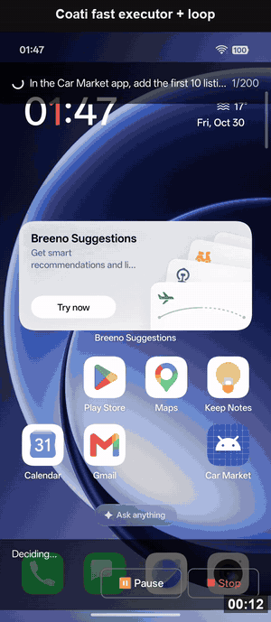

# Coati Agent

**あなたの Android スマートフォンに住む AI エージェント**

ほしい結果を伝えるだけ。Coati Agent がアプリを操作し、必要ならコードを実行して、本当に完了したかを確かめます。パソコンも ADB も不要です。

[English](README.md) · [Español](README.es.md) · [中文](README.zh-CN.md) · **日本語** · [한국어](README.ko.md)

---

## Coati Agent を選ぶ理由

スマートフォンはほとんど何でもできますが、結局は自分の手で操作しなければなりません。アプリを開き、何かをコピーし、別のアプリに切り替え、同じ画面をまたタップする。そうした作業を Coati Agent が引き受けます。普段の言葉で頼めば、頼れる友人のように画面の上で作業を進めます。

- **スマートフォンの中で動きます。** アプリを 1 つ入れるだけで、パソコンもケーブルも root も不要です。
- **今使っているアプリがそのまま使えます。** プラグインを待つ必要はありません。タップで使えるアプリなら、たいてい Coati Agent も操作できます。
- **タップだけでなく、ものを作れます。** 小さな Linux 環境を内蔵しており、情報を集めて処理し、完成した PDF、グラフ、表を届けます。
- **自分の作業を確認します。** 画面で確かめられて初めて完了とみなします。確認できないときは、そのまま伝えます。
- **主導権はあなたに。** すべての手順が見え、いつでも一時停止や中止ができます。API キーはスマートフォンの中に保存されます。

**こんなふうに頼めます:**

- *「平日の 7:30 にアラームをセットして、世界時計に東京を追加して。」*
- *「12 月 12 日から 14 日まで、評価 8.0 以上の東京のホテルを 2 軒探して、料金をメモに保存して。」*
- *「このアプリの最初の 5 件を読んで、価格を比較した PDF を作って。」*

魔法ではありません。簡単な作業では自分でやるより遅いこともあり、間違えることもあるので、重要なことは確認してください。Coati Agent はご自身の AI モデルのアカウントを使い、利用量に応じてプロバイダーから課金される場合があります。

## はじめに

Android 11 以降のスマートフォン（arm64。最近の機種のほとんどが該当します）と AI モデルの API キーが必要です。[Google Gemini のキー](https://aistudio.google.com/apikey)から始めるのが簡単です。

1. **インストール。** スマートフォンで [Releases](https://github.com/coati-os/coati-agent/releases/latest) から APK をダウンロードして開きます。Android に確認されたら、このソースからのインストールを許可してください。
2. **設定。** Coati Agent を開き、案内に従ってオーバーレイと**ユーザー補助**の権限をオンにして、*AI Model Configuration* に API キーを入力します。Android 13 以降でユーザー補助のスイッチがグレーのときは、システム設定のアプリ情報を開き、**⋮** メニューから制限付き設定を許可してください。
3. **頼む。** 浮かんでいる Coati Agent のボタンをタップして、ほしい結果を入力します。パネルに各手順が表示され、いつでも一時停止や中止ができます。

## デモ

### Linux ワークスペース：アプリから完成したファイルまで

https://github.com/user-attachments/assets/e50647c7-1d8b-4ee8-8af9-a5a702b55a5b

### 日常のタスク

https://github.com/user-attachments/assets/24384019-9561-482a-ae9f-30cc6ec87f0c

### 繰り返し操作：254 秒 → 47 秒

https://github.com/user-attachments/assets/fb831034-b329-4b8a-a25b-fdd2b382c192

### AppMemory：初回 18 ステップ、学習後 6 ステップ

https://github.com/user-attachments/assets/e3d520af-a866-4f61-b647-075994f30fa7

### アプリをまたぐ操作：Booking.com → Google Keep

https://github.com/user-attachments/assets/e3babe08-9d76-4f92-b60b-f266a8fa7317

## プライバシーと安全

- スクリーンショットと画面の説明は、設定したモデルプロバイダーに送信されます。
- 権限やインストールのダイアログは、完全信頼を選ばない限りあなたに戻されます。
- Linux ワークスペースはアプリ自身の権限でコマンドを実行し、インターネットに接続できます。セキュリティ上の境界ではありません。

## 詳しく知る

評価結果、技術的な仕組み、実験の再現については[英語の README](README.md) と[論文](https://arxiv.org/abs/2611.02644)をご覧ください。

## ライセンス

Coati Agent は [PolyForm Noncommercial License 1.0.0](LICENSE) のもと、個人利用および非商用利用は無料です。商用利用には別途ライセンスが必要です。[英語の README](README.md#license) をご覧ください。この翻訳は参考用であり、英語の本文が優先します。
