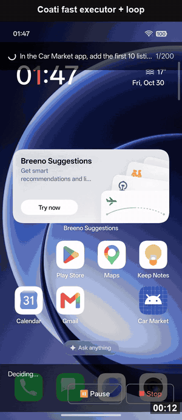

# Coati Agent

**내 Android 휴대폰 안에 사는 AI 에이전트**

원하는 결과만 말하세요. Coati Agent가 앱을 조작하고, 필요하면 코드를 실행하고, 일이 정말 끝났는지 확인합니다. 컴퓨터도 ADB도 필요 없습니다.

[English](README.md) · [Español](README.es.md) · [中文](README.zh-CN.md) · [日本語](README.ja.md) · **한국어**

---

## 왜 Coati Agent인가요

휴대폰으로 거의 모든 일을 할 수 있지만, 여전히 직접 해야 합니다. 앱을 열고, 무언가를 복사하고, 다른 앱으로 옮겨 가고, 같은 화면을 또 누릅니다. 그 일을 Coati Agent가 대신합니다. 평소 말하듯 부탁하면 믿음직한 친구처럼 화면에서 일을 처리합니다.

- **휴대폰 안에서 동작합니다.** 앱 하나만 설치하면 됩니다. 컴퓨터, 케이블, 루팅이 필요 없습니다.
- **지금 쓰는 앱을 그대로 씁니다.** 플러그인을 기다릴 필요가 없습니다. 눌러서 쓸 수 있는 앱이라면 대개 Coati Agent도 조작할 수 있습니다.
- **누르기만 하지 않고 만들어 냅니다.** 작은 Linux 환경이 내장되어 있어 정보를 모으고 처리해 완성된 PDF, 차트, 표를 전달합니다.
- **자기 작업을 확인합니다.** 화면으로 확인되어야 완료로 봅니다. 확인할 수 없으면 그대로 알려 줍니다.
- **결정은 사용자가 합니다.** 모든 단계를 볼 수 있고 언제든 일시 중지하거나 멈출 수 있습니다. API 키는 휴대폰에만 저장됩니다.

**이렇게 부탁해 보세요:**

- *"평일 7시 30분에 알람을 맞추고 세계 시계에 도쿄를 추가해 줘."*
- *"12월 12일부터 14일까지 평점 8.0 이상인 도쿄 호텔 두 곳을 찾아서 가격을 메모에 저장해 줘."*
- *"이 앱의 처음 다섯 항목을 읽고 가격을 비교한 PDF를 만들어 줘."*

마법은 아닙니다. 간단한 일은 직접 하는 것보다 느릴 수 있고 실수할 수도 있으니 중요한 일은 확인해 주세요. Coati Agent는 사용자 본인의 AI 모델 계정을 사용하며, 제공업체가 사용량에 따라 요금을 청구할 수 있습니다.

## 시작하기

Android 11 이상 휴대폰(arm64, 최근 휴대폰은 대부분 해당)과 AI 모델 API 키가 필요합니다. [Google Gemini 키](https://aistudio.google.com/apikey)로 시작하는 것이 가장 쉽습니다.

1. **설치.** 휴대폰에서 [Releases](https://github.com/coati-os/coati-agent/releases/latest)의 APK를 내려받아 엽니다. Android가 물으면 이 출처의 설치를 허용하세요.
2. **설정.** Coati Agent를 열고 안내에 따라 오버레이와 **접근성** 권한을 켠 뒤 *AI Model Configuration*에 API 키를 입력합니다. Android 13 이상에서 접근성 스위치가 회색이면 시스템 설정의 앱 정보에서 **⋮** 메뉴를 눌러 제한된 설정을 허용하세요.
3. **부탁.** 떠 있는 Coati Agent 버튼을 누르고 원하는 결과를 입력합니다. 패널에 각 단계가 표시되며 언제든 일시 중지하거나 멈출 수 있습니다.

## 데모

### Linux 작업 공간: 앱에서 완성된 파일까지

https://github.com/user-attachments/assets/e50647c7-1d8b-4ee8-8af9-a5a702b55a5b

### 일상 작업

https://github.com/user-attachments/assets/24384019-9561-482a-ae9f-30cc6ec87f0c

### 반복 작업: 254초 → 47초

https://github.com/user-attachments/assets/fb831034-b329-4b8a-a25b-fdd2b382c192

### AppMemory: 처음 18단계, 학습 후 6단계

https://github.com/user-attachments/assets/e3d520af-a866-4f61-b647-075994f30fa7

### 여러 앱에 걸친 작업: Booking.com → Google Keep

https://github.com/user-attachments/assets/e3babe08-9d76-4f92-b60b-f266a8fa7317

## 개인정보와 안전

- 스크린샷과 화면 설명은 사용자가 설정한 모델 제공업체로 전송됩니다.
- 권한 및 설치 대화상자는 완전 신뢰를 선택하지 않는 한 사용자에게 넘겨집니다.
- Linux 작업 공간은 앱 자체의 권한으로 명령을 실행하고 인터넷에 접속할 수 있습니다. 보안 경계는 아닙니다.

## 더 알아보기

평가 결과, 기술 원리, 실험 재현은 [영어 README](README.md)와 [논문](https://arxiv.org/abs/2611.02644)을 참고하세요.

## 라이선스

Coati Agent는 [PolyForm Noncommercial License 1.0.0](LICENSE)에 따라 개인 및 비상업적 사용은 무료입니다. 상업적 사용에는 별도 라이선스가 필요합니다. [영어 README](README.md#license)를 참고하세요. 이 번역은 참고용이며 영어 원문이 우선합니다.
