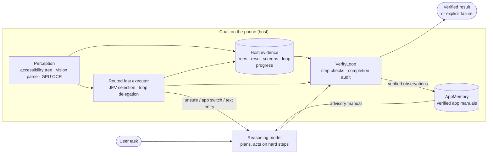

<div align="center">

# Coati

**Host-Grounded Execution for Installable Mobile GUI Agents**

[](#results)
[](#getting-started)
[](LICENSE)

An AI agent you install on your Android phone. Describe the result you want; Coati operates your other
apps to get there, and reports success only when it can show it.

[Paper — link coming soon](#citation) ·
[Demo](#demo) ·
[Results](#results) ·
[How it works](#how-it-works) ·
[Getting started](#getting-started) ·
[Reproducing the paper](#reproducing-the-paper)

</div>

---

Most mobile GUI agents run on a computer that drives a phone over a debugging bridge, out of reach
of ordinary users. **Coati ships as an Android app** and operates other apps through Android's
accessibility service. Running on the phone gives it something a model alone lacks: **host-recorded
evidence** of what actually happened on screen — accessibility trees, result screens across apps,
the progress of a repeated action. Coati grounds its execution in this evidence:

- **VerifyLoop** accepts a step or a completion only when host evidence confirms it.
- **AppMemory** learns per-app manuals solely from verified observations and reuses them later.
- A **routed fast executor** lets a small selection model take simple, confident steps, and lets the
  host repeat loops of simple steps that the large model plans once.

## Demo

All demos are screen recordings on a ColorOS phone running the public build; side-by-side clips are
synchronized, never sped up.

### Cross-app task — Maps → Keep → Calendar
*"Find the address and opening hours of the National Museum of Singapore in Google Maps. Save them in
a Google Keep note titled "Singapore day out". Then create a Google Calendar event titled "Visit
National Museum" on November 7, 2026, from 10 AM to noon, Singapore time, using the address you found."*

<!-- VIDEO V1: National Museum cross-app task (Maps → Keep → Calendar), ends on the verified completion -->
> 🎬 *Demo video coming soon.*

### Loops of simple steps — classic vs. fast executor
*"In the Car Market app, add the first 10 listings to your favorites."* Same task, side by side.

<!-- VIDEO V2: R1 favorites, classic mode (left) vs. JEV fast executor (right), side by side -->
> 🎬 *Demo video coming soon.*

### AppMemory — first visit vs. after learning
A deep, rarely used page in an unfamiliar app: the first run explores, the fourth goes straight there.

<!-- VIDEO V3: Manual Lab "实验档案" page, run 1 (exploring) vs. run 4 (direct, with the learned manual) -->
> 🎬 *Demo video coming soon.*

### Everyday tasks with the fast executor

<!-- VIDEO V4: 2–3 everyday tasks in JEV mode (e.g. set an alarm, create a contact) -->
> 🎬 *Demo video coming soon.*

<!-- VIDEO V5 (optional): install Coati, enter model keys, send the first command -->

## Results

AndroidWorld, all 116 tasks, with **Gemini 3.8 Flash as the backbone of every agent**. Every agent
runs through the same harness, task instances, step budgets and official scorer.

| Agent | Controls the phone via | Trials | Success rate | False completions |
|---|---|---|---|---|
| **Coati** | accessibility only | 3 | **86.5%** (89.7 / 87.1 / 82.8) | **5.4%** |
| Artemis | accessibility only | 3 | 77.6% | – |
| Artemis | ADB | 1 | 76.5% | – |
| FinalRun | ADB | 1 | 59.9% | 14.5% |
| Midscene.js | ADB | 1 | 59.1% | 7.5% |

Coati solves 95 of the 116 tasks in all three trials. The ablation and per-app breakdown are in the
paper.

Beyond the benchmark — whose tasks are short first visits — in everyday-use experiments:

| What | Result |
|---|---|
| Fast executor on seven everyday phone tasks | **−39%** median time (64 → 39 s), **−25%** model tokens, comparable success |
| Fast executor on loops of simple steps (favorite, compare, hide in a 40-item list) | **2.8–5.4×** faster with **6–9×** fewer model tokens, equal or higher success |
| AppMemory on a deep route in an unfamiliar app (3 independent learning sessions) | **18.5 → 6–7** steps, median **190 → 77 s** |
| Fast executor on an Android 16 phone (9 tasks × 3 runs: native, canvas, Flutter, permission dialogs) | **27/27** runs vs 26/27, median **110.5 → 78.6 s**, Reasoning calls on the critical path **285 → 67** |
| AppMemory on the same phone | deep route: **22** steps (222 s) on the first visit, then **5** steps (about 22 s) |

## How it works



**VerifyLoop.** Every action is checked against the screen before and after it, by host evidence
(pixel changes at the target, tree texts, target state) or a compact model check. A completion
claim goes to an independent audit that sees the last result screen of every app the task used and,
for delegated loops, the host's record of which items were handled. If the audit cannot run, the
task ends as *done but unverified* instead of a plain "Task complete".

**AppMemory.** Per-app manuals (pages, routes, controls) are learned only from observations the
verification accepted, bound to the app's version, and offered to the Reasoning model as advisory
context on later visits. They help most on deep, rarely used routes in unfamiliar apps.

**Routed fast executor.** A small selection model (JEV) picks among actions the host builds from the
accessibility tree, and the host taps the element's own bounds. Unsure choices, app switches and text
entry go to the Reasoning model. For a repetitive sub-task, the large model plans the loop once
(per-item action, count, stop condition) and the host repeats it item by item without a model call
per item, recording progress as evidence. The speed–accuracy trade-off is a user setting:

| Mode | Fast path takes |
|---|---|
| Fast | every goal-directed step, text entry included |
| **Balanced** (default) | goal-directed steps; unfamiliar screens go to the Reasoning model |
| Accurate | only confident goal-directed steps |

Details: [`docs/jev-executor.md`](docs/jev-executor.md).

## Getting started

**Requirements**
- Android 11 (API 30) or newer, phone or emulator
- A model API key for the Reasoning and Fast models (Gemini is recommended; other providers and
  OpenAI-compatible endpoints are supported)
- Optional: a JEV key for the fast executor (without it, every step uses the Reasoning model)
- To build: JDK 17+ and the Android SDK

**Install**

Download the latest APK from [Releases](../../releases) and install it (allow installation from
unknown sources when Android asks), or build it yourself:

```sh
./gradlew :app:assembleDebug
adb install -r app/build/outputs/apk/debug/app-debug.apk
```

**First run**
1. Open Coati and follow onboarding: grant the overlay and **accessibility** permissions.
2. Enter your model provider and API key (*AI Model Configuration*), and optionally your JEV key
   (*Settings → JEV*).
3. Pick a mode under *Settings → Speed and accuracy* and, optionally, *App knowledge*
   (off / use guides / use and learn).
4. Type the result you want, e.g. *"Set an alarm for 7:30 AM in the Clock app."* The floating panel
   shows each step; pause or stop at any time.

Keys stay on the device and are sent only to the providers you configure.

## Reproducing the paper

| Experiment | Where | Notes |
|---|---|---|
| AndroidWorld (Coati, ablations, opponents) | [`scripts/androidworld`](scripts/androidworld/README.md) | APK adapter around the official AW task runner; `--config C1/C2/C3/C4`, `--provider google`, `--routing`; opponents via `--agent midscene` / `--agent finalrun` |
| Everyday and device tasks, Car Market loops | [`scripts/device_bench`](scripts/device_bench/README.md) | `python run_app_bench.py <out> R1,R2,R3,R4 classic,jev 5`; `python marketplace.py repeat-summary <out>` |
| AppMemory learning | [`scripts/device_bench`](scripts/device_bench/README.md) | `python run_learning_bench.py <out> classic 2` |
| Fixture apps | [`test-apps/living-manual-lab`](test-apps/living-manual-lab/README.md), [`test-apps/marketplace`](test-apps/marketplace/README.md), `test-apps/interrupter` | Offline, deterministic; outcomes checked from the apps' saved state |

```sh
./gradlew :test-apps:living-manual-lab:installV1Debug
./gradlew :test-apps:marketplace:assembleDebug
adb install -r test-apps/marketplace/build/outputs/apk/debug/marketplace-debug.apk
```

The AndroidWorld harness records each episode's full identity (sources, parameters, budget, APK,
transport) and never replays or overwrites a scored episode; see its README for the pinned
environment and credential rules.

## Safety, privacy and platform

- **You stay in control.** Permission and installation dialogs are handed back to you (unless you
  choose full trust); every action happens visibly on screen; tasks can be paused or stopped at any
  time, and risky actions ask for confirmation.
- **Privacy.** Screenshots and screen descriptions are sent to the model providers you configure.
  AppMemory stores only admitted, sanitized page facts on the device.
- **Distribution.** Coati operates other apps through the accessibility service, which Google Play's
  AccessibilityService policy does not permit for autonomous agents, so it is distributed for direct
  installation. In July 2026 the European Commission adopted binding measures under the Digital
  Markets Act requiring Google to give third-party AI assistants equal access to Android features,
  including performing actions in apps (IP/26/1634).

## Repository layout

| Path | Contents |
|---|---|
| `app/` | The Coati Android app: agent loop, VerifyLoop, AppMemory, JEV fast executor, perception, overlay UI |
| `scripts/androidworld/` | AndroidWorld harness for Coati and opponent agents |
| `scripts/device_bench/` | Device benchmarks, Car Market tasks and checker, learning benchmark |
| `test-apps/` | Fixture apps: Manual Lab, Car Market, Interrupter |
| `docs/` | Design notes (fast executor, OCR inputs, local relay) and device validation reports |

## Citation

Pu Shi and Yudou Ying contributed equally; Yuhua Zheng is the corresponding author.

```bibtex
@misc{shi2026coati,
  title  = {Coati: Host-Grounded Execution for Installable Mobile GUI Agents},
  author = {Pu Shi and Yudou Ying and Hanlei Shi and Yuhua Zheng},
  year   = {2026},
  note   = {Under review}
}
```

## License

Coati is free for **noncommercial use** under the
[PolyForm Noncommercial License 1.0.0](LICENSE): personal use, research, education, and use by
noncommercial organizations such as universities and public research institutions.

**Commercial use requires a separate license.** This includes use inside a company, in a commercial
product or service, or to provide services to others for a fee. Aspects of Coati are the subject of a
patent application; for a commercial license, contact the patent holder identified by the patent
number in [PATENTS.md](PATENTS.md).

## Acknowledgments

<!-- ACKNOWLEDGMENTS: to be added -->
