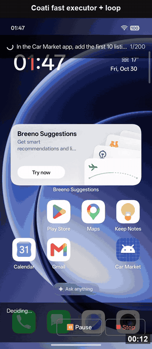

# Coati Agent

**住在你 Android 手机里的 AI 智能体**

告诉它你想要的结果。Coati Agent 会操作你的 App，需要时运行代码，并确认事情真的办成了。不需要电脑，也不需要 ADB。

[English](README.md) · [Español](README.es.md) · **中文** · [日本語](README.ja.md) · [한국어](README.ko.md)

---

## 为什么选择 Coati Agent

手机几乎什么都能做，但很多事还得你亲自动手：打开一个 App，复制点东西，切到另一个 App，再把同样的页面点一遍。这些事可以交给 Coati Agent。用平常说话的方式告诉它，然后看它在屏幕上替你完成，就像有个靠谱的朋友在帮忙。

- **就在你的手机上。** 只需安装一个 App，不需要电脑、数据线或 root。
- **直接用你现有的 App。** 不用等谁做插件：你能点着用的 App，Coati Agent 通常也能操作。
- **不只会点屏幕，还能做东西。** 内置一台小型 Linux 电脑，可以收集信息、处理数据，交给你一份做好的 PDF、图表或表格。
- **自己检查结果。** 屏幕上看得到结果，任务才算完成；确认不了，它会如实告诉你。
- **你说了算。** 每一步都看得见，随时可以暂停或停止。API Key 只保存在你的手机上。

**你可以这样说:**

- *“工作日早上 7:30 设个闹钟，再把东京加到世界时钟。”*
- *“找两家东京 12 月 12 日到 14 日、评分 8.0 以上的酒店，把价格记到笔记里。”*
- *“读一下这个 App 里前五条商品，给我做一份比较价格的 PDF。”*

它不是魔法：简单的事可能比你自己做得慢，也可能出错，重要的事情请留意一下。Coati Agent 使用你自己的 AI 模型账户，模型服务商可能按用量收费。

## 开始使用

你需要一台 Android 11 或更新版本的手机（arm64，近几年的手机基本都是），以及一个 AI 模型的 API Key。最简单的是从 [Google Gemini Key](https://aistudio.google.com/apikey) 开始。

1. **安装。** 在手机上从 [Releases](https://github.com/coati-os/coati-agent/releases/latest) 下载 APK 并打开。如果 Android 询问，请允许从该来源安装。
2. **设置。** 打开 Coati Agent，按提示开启悬浮窗和**无障碍**权限，然后在 *AI Model Configuration* 中填入 API Key。在 Android 13 及以上，如果无障碍开关是灰色的，请到系统设置的应用信息页，点右上角 **⋮** 菜单，选择允许受限设置。
3. **开口。** 点击悬浮的 Coati Agent 按钮，输入你想要的结果。面板会显示每一步，你可以随时暂停或停止。

## 真机演示

### Linux 工作区：从 App 到成品文件

https://github.com/user-attachments/assets/e50647c7-1d8b-4ee8-8af9-a5a702b55a5b

### 日常任务

https://github.com/user-attachments/assets/24384019-9561-482a-ae9f-30cc6ec87f0c

### 重复操作：254 秒 → 47 秒

https://github.com/user-attachments/assets/fb831034-b329-4b8a-a25b-fdd2b382c192

### AppMemory：第一次 18 步，学会后 6 步

https://github.com/user-attachments/assets/e3d520af-a866-4f61-b647-075994f30fa7

### 跨 App：Booking.com → Google Keep

https://github.com/user-attachments/assets/e3babe08-9d76-4f92-b60b-f266a8fa7317

## 隐私与安全

- 屏幕截图和屏幕描述会发送给你配置的模型服务商。
- 权限和安装弹窗会交还给你处理，除非你选择完全信任模式。
- Linux 工作区以 App 自身的权限运行命令，可以联网，它不是安全边界。

## 了解更多

评测结果、技术原理和实验复现请看[英文 README](README.md) 和[论文](https://arxiv.org/abs/2611.02644)。

## 许可证

Coati Agent 依据 [PolyForm Noncommercial 1.0.0 许可证](LICENSE)，供个人和非商业用途免费使用。商业使用需要另行授权，详见[英文 README](README.md#license)。本译文仅供参考，以英文文本为准。
